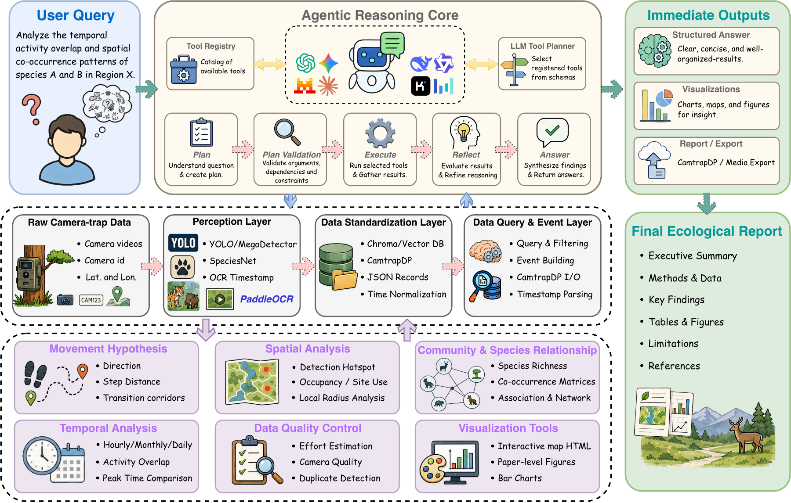
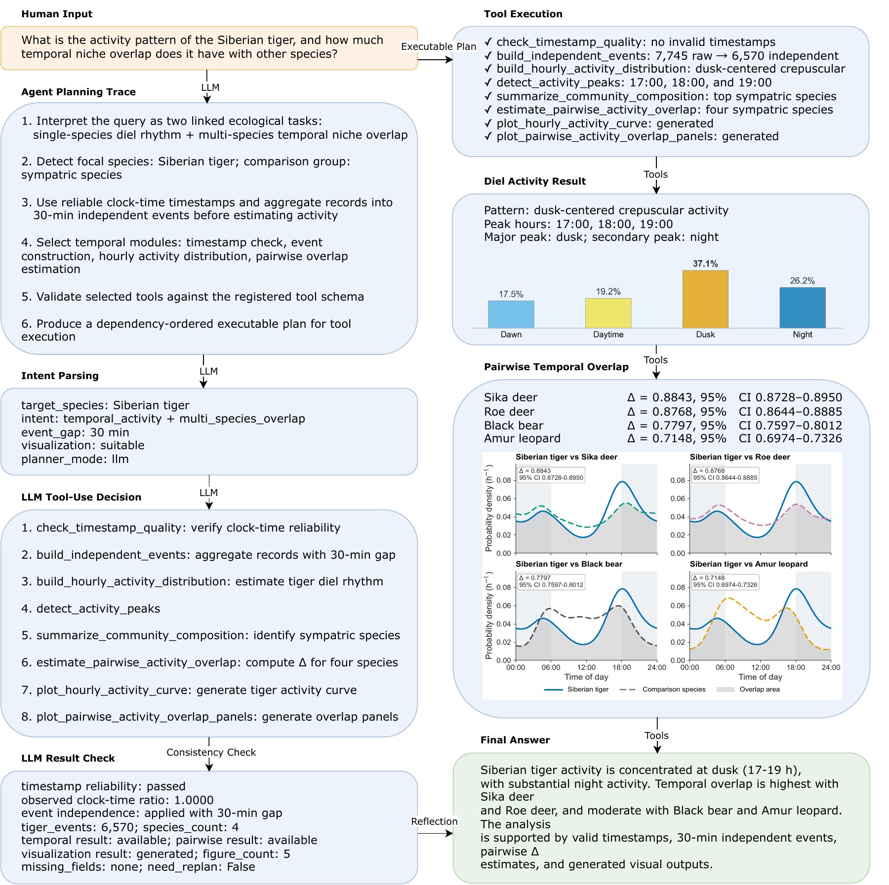
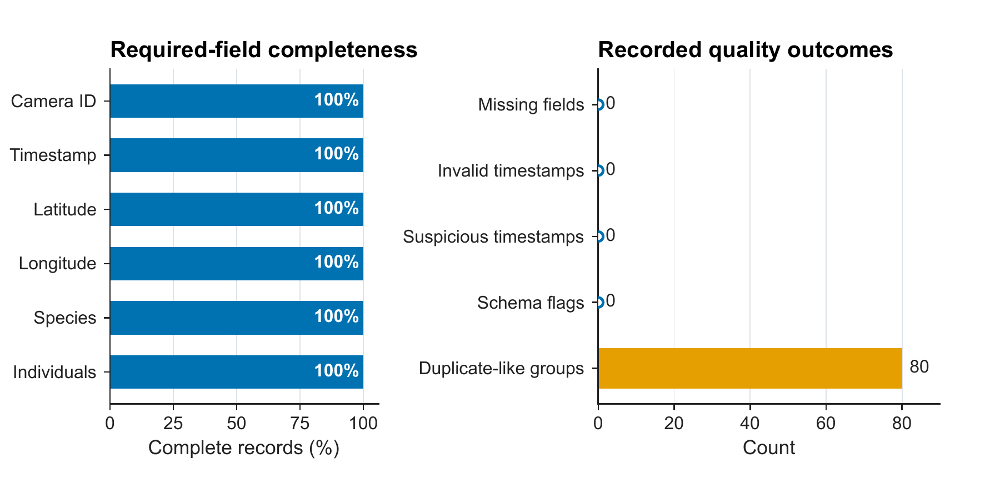
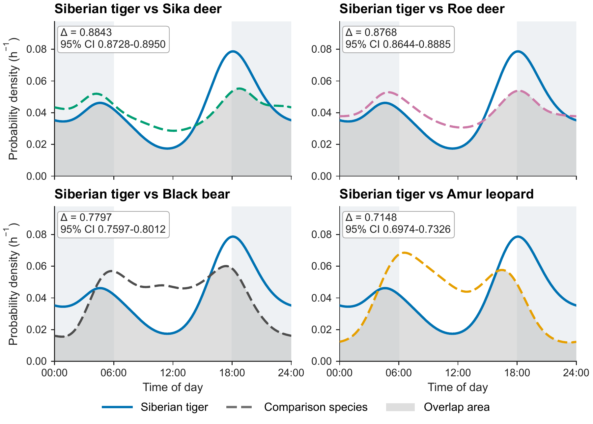
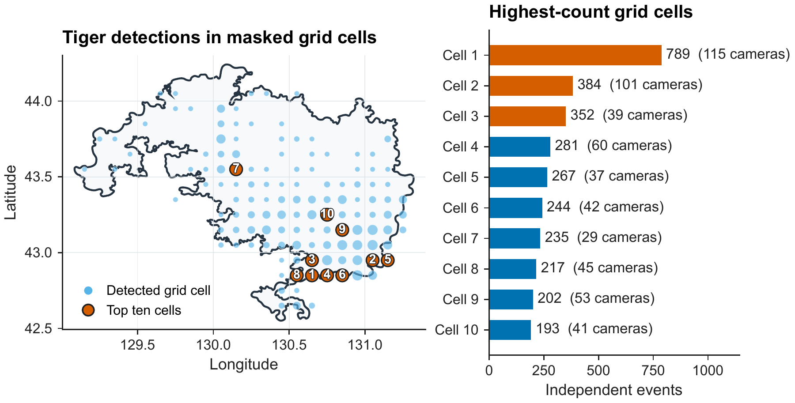
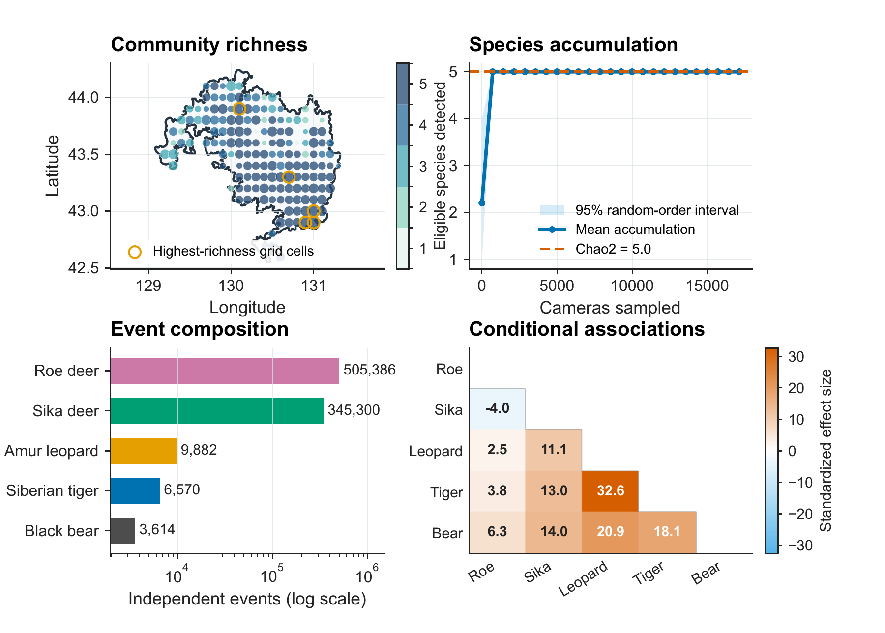
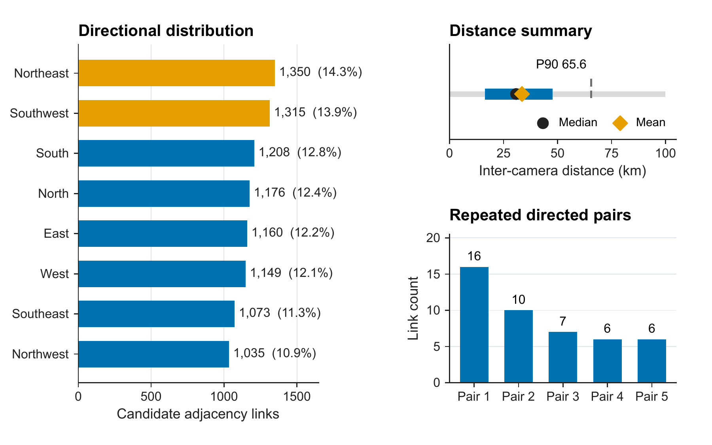
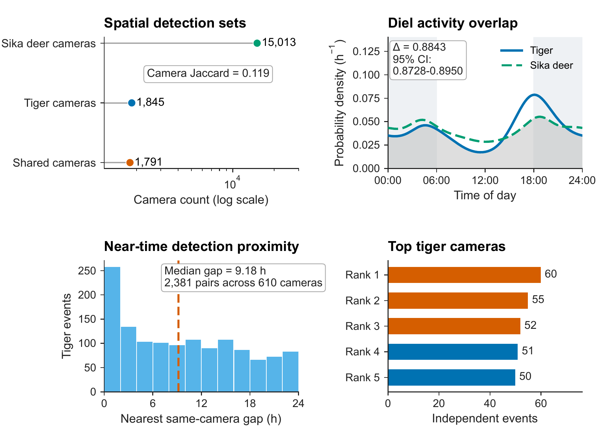

<div align="center">

# CamAgent

**An LLM-agent framework for multi-species camera-trap workflows**

Yutong Deng<sup>1†</sup>, Qi Song<sup>2,3†</sup>, Xi Guo<sup>4</sup>, Tianming Wang<sup>2,3</sup>, Lei Bao<sup>2,3*</sup>, Jianping Ge<sup>2,3*</sup>

<sup>1</sup>Faculty of Arts and Sciences, Beijing Normal University &nbsp;·&nbsp; <sup>2</sup>College of Life Sciences, Beijing Normal University<br>
<sup>3</sup>NFGA Key Laboratory for Conservation Ecology of Northeast Tiger and Leopard &nbsp;·&nbsp; <sup>4</sup>Faculty of Geographical Science, Beijing Normal University<br>
<sup>†</sup>Equal contribution &nbsp;·&nbsp; <sup>*</sup>Corresponding authors

[](http://arxiv.org/abs/2609.39112)
[](https://github.com/Gululu0503/CamAgent/actions/workflows/tests.yml)
[](#installation)
[](https://camtrap-dp.tdwg.org/)
[](LICENSE)

Ask an ecological question in plain language. CamAgent plans which registered tools to run, executes them on CamtrapDP data, and returns results, figures, and a report.



</div>

CamAgent was developed and tested on 1,376,017 media records from 17,129 camera identifiers in Northeast China Tiger and Leopard National Park (January 2023 – September 2024). Five species were analysed: Siberian tiger, Amur leopard, sika deer, Siberian roe deer, and Asiatic black bear.

| Species | Scientific name | Media records | Independent events |
|---|---|---:|---:|
| Siberian tiger | *Panthera tigris altaica* | 7,745 | 6,570 |
| Amur leopard | *Panthera pardus orientalis* | 11,704 | 9,882 |
| Sika deer | *Cervus nippon* | 625,249 | 345,300 |
| Siberian roe deer | *Capreolus pygargus* | 727,090 | 505,386 |
| Asiatic black bear | *Ursus thibetanus* | 4,229 | 3,614 |

## Contents

- [Overview](#overview)
- [Installation](#installation)
- [Validate the artifact](#validate-the-artifact)
- [Quick start](#quick-start)
- [Paper experiments](#paper-experiments)
- [Data](#data)
- [Analysis conventions](#analysis-conventions)
- [Repository layout](#repository-layout)
- [Citation](#citation)
- [Contact](#contact)

## Overview

Camera-trap archives now hold millions of records, but turning them into ecological results still means stitching together detectors, spreadsheets, and scripts. CamAgent connects these steps into one query-driven workflow.

The framework has three parts:

- **Agentic Reasoning Core.** The LLM reads the question and the tool schemas and drafts a plan of tool calls. It then reflects on what the tools returned and writes the answer. A local runtime checks each call's tool name, arguments, dependencies, and preconditions, then runs it.
- **Data Layer.** This is where raw media and tables become standardized records.
  - Perception: SpeciesNet for images and sampled video frames, MegaDetector or YOLO sidecar results, and PaddleOCR for timestamps burned into frames.
  - Timestamp and coordinate normalization, then CamtrapDP import and export.
  - JSON or Chroma storage, filtering, and independent-event construction.
- **Ecological Tool Modules.** There are six modules: data quality, temporal activity, spatial distribution and occupancy, community and species relationships, movement hypotheses, and visualization. The registry holds 121 tools; 97 of them are exposed to the planner.

The LLM chooses which analyses to run, and all numbers and figures are computed by Python functions.

| Module | What it does | Main code |
|---|---|---|
| Data quality | Missing fields, invalid or synthetic timestamps, schema flags, duplicate-like trigger groups, per-camera completeness | `quality_tools.py` |
| Temporal activity | Von Mises kernel diel activity, overlap coefficient Δ with bootstrap intervals, peaks and activity windows | `temporal_tools.py` |
| Spatial + occupancy | Camera-level hotspots, privacy-masked grid maps, detection histories, single-season occupancy with documented camera effort | `spatial_tools.py` |
| Community | Observed and Chao2 richness, species accumulation, Hill numbers (alpha/gamma), Jaccard and Bray–Curtis, Baselga turnover/nestedness, and hypergeometric shared-camera tests with Benjamini–Hochberg FDR | `spatial_tools.py` (`infer_complete_community`) |
| Movement hypotheses | Inter-camera links under time/distance limits: distances, directions, repeated pairs | `movement_tools.py` |
| Visualization | Activity, overlap, community, hotspot, occupancy, and interactive maps | `visualization_tools.py`, `ecology_figures.py` |

## Installation

Python 3.10–3.12 is supported.

```bash
git clone https://github.com/Gululu0503/CamAgent.git
cd CamAgent
python -m venv .venv
source .venv/bin/activate              # Windows: .venv\Scripts\activate
python -m pip install -e '.[test]'
```

Or with Conda: `conda env create -f environment.yml`.

Optional extras:

| Extra | Adds | Needed for |
|---|---|---|
| `agent` | chromadb, langchain-core, langchain-openai, python-dotenv | live natural-language agent |
| `visualization` | folium, geopandas, networkx, seaborn | maps and network figures |
| `perception` | opencv-python, pillow, speciesnet | image and video perception |
| `ocr` | paddleocr, paddlepaddle | reading burned-in timestamps |
| `all` | everything above | full workflow |

## Validate the artifact

Run the checks:

```bash
python scripts/validate_review_artifact.py
python -m pytest -q
python scripts/run_agent_stress_matrix.py --output-dir results/agent_stress/stress_60
```

Expected results:

- Artifact validation passes (question, trace, and code hashes, plus the synthetic example).
- `134 passed`.
- All 60 agent stress cases pass.

## Quick start

**Deterministic pipeline on the included synthetic CamtrapDP package**

```bash
python scripts/run_research_pipeline.py --config configs/example_pipeline.json
```

**Live agent**

Copy `.env.example` to `.env` and set a provider. DeepSeek, OpenAI-compatible endpoints, and Azure OpenAI are supported.

```bash
export LLM_PROVIDER=deepseek
export DEEPSEEK_API_KEY="<your-api-key>"
export DEEPSEEK_MODEL=deepseek-v4-flash

python run_agent.py chat \
  --question "What is the activity pattern of the Siberian tiger, and how much temporal niche overlap does it have with other species?" \
  --full-trace
```

Other subcommands are `sync-db`, `recognize-image` (MegaDetector + SpeciesNet), and `convert-csv`. Run `python run_agent.py <command> --help` for options.

## Paper experiments

Six prespecified questions (`configs/paper_query_experiments.json`, also listed in `results/paper_query_experiments/QUESTIONS.md`) were run through the agent. Each run has a public trace, and its hash is recorded in the manifest.

Every call the agent proposed passed validation and ran, and the six runs produced 11 figures.

| ID | Question type | Tools chosen by the agent (start of plan) | Trace |
|---|---|---|---|
| QUAL | Data quality | `check_missing_fields`, `detect_invalid_timestamps`, `detect_label_noise`, … (6 calls) | [QUAL](results/paper_query_experiments/QUAL_public_trace.json) |
| TEMP | Activity and overlap | `check_timestamp_quality`, `build_independent_events`, `estimate_pairwise_activity_overlap`, … (8 calls) | [TEMP](results/paper_query_experiments/TEMP_public_trace.json) |
| SPAT | Detection hotspots | `build_hotspot_rank`, `plot_species_distribution_static` | [SPAT](results/paper_query_experiments/SPAT_public_trace.json) |
| COMM | Community inference | `infer_complete_community`, `plot_complete_community_inference` | [COMM](results/paper_query_experiments/COMM_public_trace.json) |
| MOVE | Movement hypotheses | `analyze_animal_movement_pattern` | [MOVE](results/paper_query_experiments/MOVE_public_trace.json) |
| INTEG | Integrated report | `check_timestamp_quality`, `analyze_data_quality`, `build_hotspot_rank`, `analyze_species_pair_relationship`, … (12 calls) | [INTEG](results/paper_query_experiments/INTEG_public_trace.json) |

Selected results from the paper:

- **QUAL.** All 7,745 tiger records are complete. 80 duplicate-like trigger groups are collapsed by the 30-min rule. Occupancy requires survey-effort data.
- **TEMP.** Tiger activity peaks at 17:00–19:00. Overlap is highest with sika deer (Δ = 0.884, 95% CI 0.873–0.895) and roe deer (0.877), and lower with black bear (0.780) and Amur leopard (0.715).
- **SPAT.** Tigers were detected at 1,845 of 17,129 cameras. The map uses 0.1° masked grid cells.
- **COMM.** Observed and Chao2 richness are both 5. Gamma Hill numbers are 2.210 (q = 1) and 2.023 (q = 2). Sørensen dissimilarity is 0.221, made up of 0.040 turnover and 0.181 nestedness. The largest association effect is Amur leopard–Siberian tiger (SES 32.6).
- **MOVE.** There are 9,466 leopard detection links (≤72 h, ≤100 km) with a median of 30.8 km and no dominant direction.

A separate end-to-end check runs from one raw camera-trap video. The planner chose the dataset-preparation tool, which sampled frames for SpeciesNet, read the timestamp with PaddleOCR, wrote and validated a CamtrapDP package, and loaded it for analysis. See [`results/raw_media_validation/raw_media_public_trace.json`](results/raw_media_validation/raw_media_public_trace.json).

<p align="center">

<br>
<sub><b>TEMP planning and execution record.</b> Question, planning trace, parsed intent, eight-call plan, and reflection check (left); execution status, activity and overlap results, and the final answer (right).</sub>
</p>

<table>
<tr>
<td width="50%" align="center"><br><sub><b>QUAL</b> data quality of tiger records</sub></td>
<td width="50%" align="center"><br><sub><b>TEMP</b> tiger activity overlap with four species</sub></td>
</tr>
<tr>
<td align="center"><br><sub><b>SPAT</b> detections on privacy-masked grid cells</sub></td>
<td align="center"><br><sub><b>COMM</b> richness, accumulation, composition, associations</sub></td>
</tr>
<tr>
<td align="center"><br><sub><b>MOVE</b> camera-detection adjacency hypotheses</sub></td>
<td align="center"><br><sub><b>INTEG</b> tiger–sika deer integrated synthesis</sub></td>
</tr>
</table>

## Data

The analytical input is a CamtrapDP package (`datapackage.json`, `deployments.csv`, `media.csv`, `observations.csv`).

- `examples/privacy_safe_camtrap_dp/` holds six invented records with invented coordinates for offline tests.
- `configs/paper_pipeline.json` records the shared empirical analysis parameters.
- To analyse your own data, point the config to your CamtrapDP package.

The full field dataset is held by the data provider. Location fields in the public traces are masked.

## Analysis conventions

- Hourly activity analyses use records with clock-time timestamps, reported in local clock time.
- Independent events are built per species and camera with a minimum gap (30 min by default). If the requested gap differs from the cached one, events are re-aggregated.
- RAI is independent events per 100 camera-days.
- Occupancy models use documented camera operation dates.
- Camera-to-camera links are summarized as movement hypotheses.

## Repository layout

```text
├── configs/        pipeline parameters, six paper questions, synthetic example config
├── examples/       privacy-safe synthetic CamtrapDP package
├── results/        six public query traces + manifest, raw-media trace
├── scripts/        artifact validator, query experiments, stress matrix, pipeline runner
├── src/camagent/   package: tools, registry, LLM agent, perception, pipeline
├── tests/          134 test cases (scientific invariants, planning, traces, raw-media pipeline)
└── run_agent.py    CLI: chat, sync-db, recognize-image, convert-csv
```

## Citation

```bibtex
@article{deng2026camagent,
  title   = {CamAgent: An LLM-Agent Framework for Multi-Species Camera-Trap Workflows},
  author  = {Deng, Yutong and Song, Qi and Guo, Xi and Wang, Tianming and Bao, Lei and Ge, Jianping},
  journal = {arXiv preprint arXiv:2609.39112},
  year    = {2026}
}
```

## License

Code is released under the [MIT License](LICENSE).

## Contact

Questions and collaboration ideas are welcome. You can open an [issue](https://github.com/Gululu0503/CamAgent/issues) or email Yutong Deng ([ytdeng2005@gmail.com](mailto:ytdeng2005@gmail.com)).
